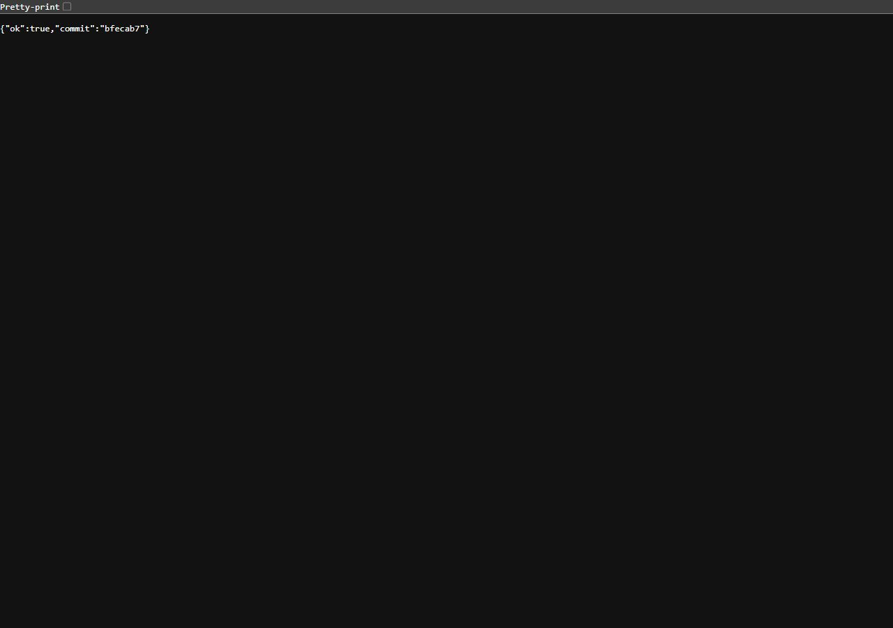
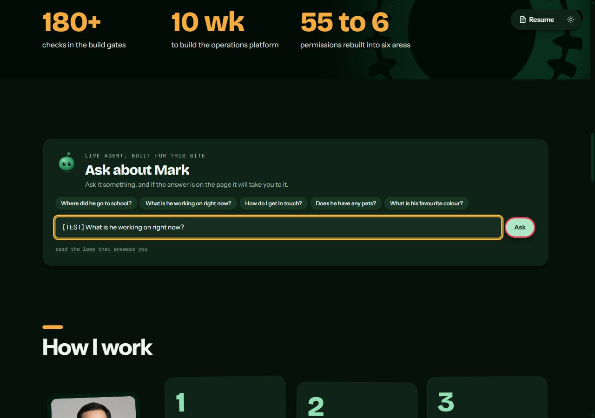
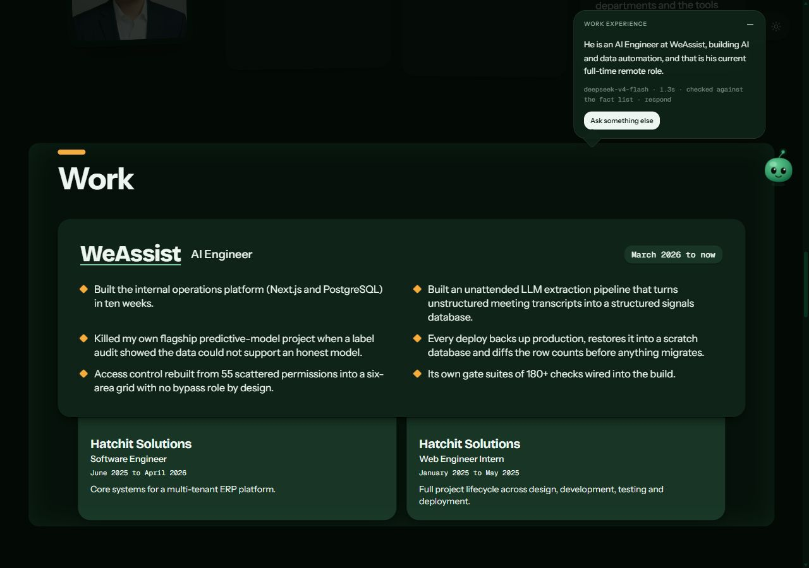
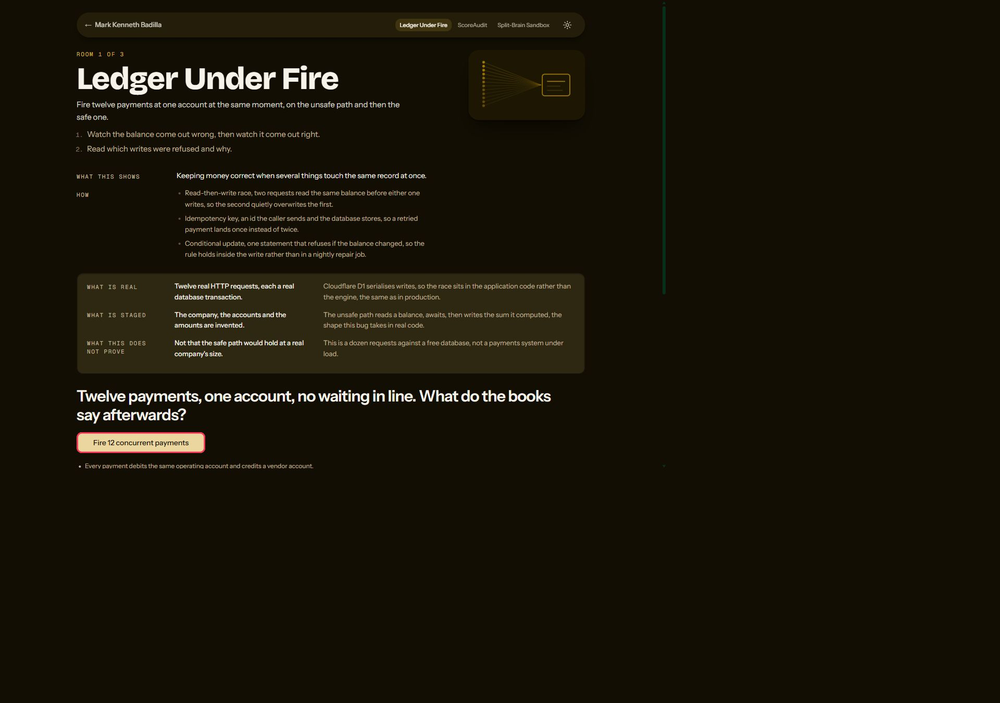
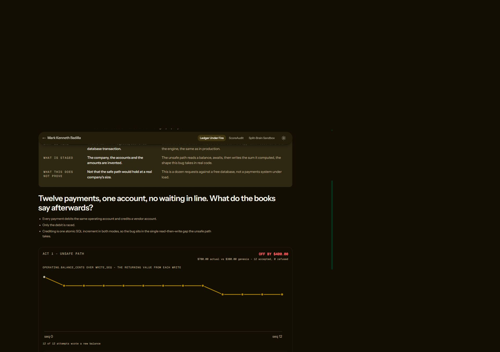
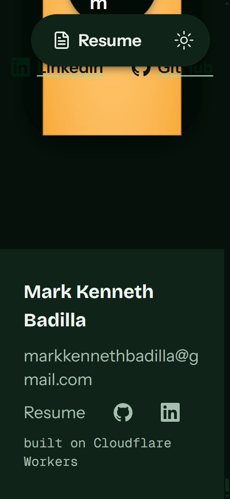
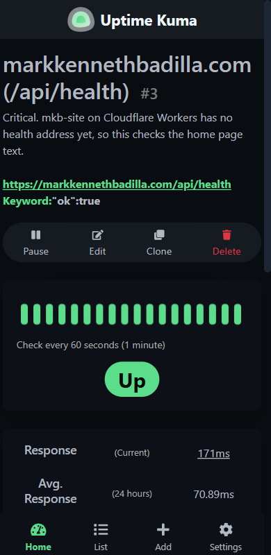

# Receipt: markkennethbadilla.com after the coverage work

For: Mark. Shot on the live site on 2026-11-22 (Manila evening), viewport 1280x900 (P4 at 390x844), commit `bfecab7`.

**What changed for a visitor**

- The guide and every demo run now pass an invisible Cloudflare bot check (Turnstile) first.
- Text at 200% no longer scrolls any page sideways (email, buttons, room header, About and Stack grids, resume chips).
- `/api/health` answers with the live commit; the outside monitor and the phone page watch it.
- PostHog records visits, errors and each guide model call.

**Path map**

| Path | What | Result |
| --- | --- | --- |
| P1 | Health address opened in a browser | PASS |
| P2 | First-time visitor asks the guide a question (bot check runs) | PASS |
| P3 | Visitor runs a demo room (bot check on run creation) | PASS |
| P4 | Phone visitor with 200% text reaches the footer | PASS |
| P5 | Outside monitor reads the health address | PASS |
| P6 | A request with no bot token is refused (403) and still recorded | BLOCKED in a real browser (the page always sends a token); proven in `worker/bot-check.test.ts` against real local D1 |
| P7 | Guide or demo endpoint fails (429 or 5xx) and the visitor tries again | Walked in `e2e/journeys.spec.ts` with a mocked failure; not forced on the live site |

## P1 Health address

**Result** You see `{"ok":true,"commit":"bfecab7"}`, the tip of main. Before the `run_worker_first` fix a browser got the static 404 page here.

## P2 Guide question

**Action** Type `[TEST] What is he working on right now?` in **Ask anything about his work**, then press **Ask** (outlined).

**Result** The guide flies to Work and answers "He is an AI Engineer at WeAssist, building AI and data automation, and that is his current full-time remote role." The run line shows deepseek-v4-flash, 1.3s, checked against the fact list.

## P3 Demo room run

**Action** Press **Fire 12 concurrent payments** (outlined).

**Result** The verdict reads `OFF BY $400.00`, "$700.00 actual vs $300.00 genesis - 12 accepted, 0 refused": the unsafe path's lost updates, as the room promises.

## P4 200% text on a phone

**Before** On the same page before this work, the page was 456 px wide in a 380 px window (the footer email could not wrap).

**After** The page width equals the window (380 = 380) and the email wraps.

## P5 Outside monitor

**Result** Uptime Kuma monitor `markkennethbadilla.com (/api/health)` is Up, keyword `"ok":true`, 171 ms, phone page ticked.

## Questions people ask

- Does asking the guide cost money? One model call on the capped key, about 0.0001 USD; the key stops at 1 USD a month.
- Why does PostHog show nothing from my own browser? An ad blocker blocks it (seen in Mark's Chrome); visitors without one are recorded.
- What if the bot check breaks? The guide and the demos say so on screen; a missing secret closes them with a message, never silently.
